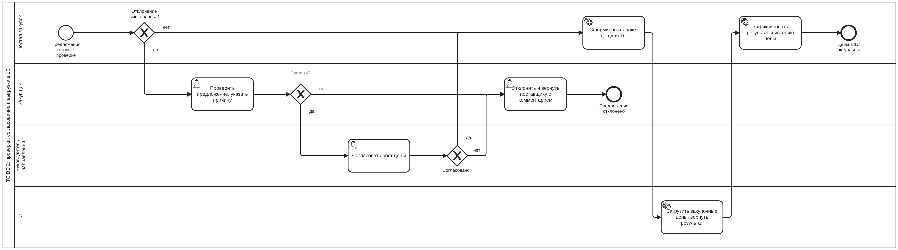

# Портал контроля закупочных цен: пакет системного аналитика

*System analysis package for a supplier price control portal in retail: AS IS / TO BE processes in BPMN, use cases, user stories with Gherkin acceptance criteria, ER model and PostgreSQL schema with executable business rules, OpenAPI spec, 1C integration design, NFRs and a traceability matrix.*

**Роль:** системный аналитик · **Стек артефактов:** BPMN 2.0, UML (use case, sequence, state), Gherkin, PostgreSQL, OpenAPI 3.0, Mermaid

Документация подготовлена по мотивам внутреннего портала закупок розничной сети, логику которого я разбирала и для которого формулировала доработки. Компании, поставщики, пользователи и цены вымышленные; процессы, проблемы и требования переработаны и обобщены.

## Задача

Розничная сеть закупает у десятков поставщиков. Прайс-листы приходят на почту в разных форматах, закупщик ищет позиции в каталоге вручную, сравнивает цены через ВПР, согласует рост в мессенджере и вводит новые цены в 1С руками. В результате рост цены можно пропустить, а вопрос «кто согласовал эту цену» остаётся без ответа.

Нужно описать систему, которая принимает прайсы, сопоставляет позиции с каталогом, пропускает мелкие изменения автоматически, отправляет значимый рост на согласование и сама выгружает согласованные цены в 1С.

## Что внутри

| # | Документ | Что показывает |
|---|---|---|
| 1 | [Видение и границы](docs/01-vision-scope.md) | проблема, цели с метриками, стейкхолдеры, что входит и не входит, глоссарий |
| 2 | [Процессы AS IS / TO BE](docs/02-processes.md) | BPMN-схемы, проблемы текущего процесса, роли и права |
| 3 | [Варианты использования](docs/03-use-cases.md) | диаграмма, 7 use case с основными и альтернативными сценариями |
| 4 | [User stories](docs/04-user-stories.md) | 11 историй в 5 эпиках, критерии приёмки на Gherkin |
| 5 | [Модель данных](docs/05-data-model.md) | ER-диаграмма, ключевые решения, словарь данных, статусная модель |
| 6 | [Интеграция с 1С](docs/06-integration-1c.md) | обмены, sequence-диаграммы, формат пакета, маппинг полей, коды ошибок, идемпотентность |
| 7 | [API](docs/07-api.md) | ресурсы и соглашения; спецификация [`api/openapi.yaml`](api/openapi.yaml) |
| 8 | [Нефункциональные требования](docs/08-nfr.md) | производительность, надёжность, безопасность с проверяемыми метриками |
| 9 | [Бизнес-правила](docs/09-business-rules.md) | правила сопоставления, расчёт отклонения, таблица решений по маршруту |
| 10 | [Матрица трассировки](docs/10-traceability.md) | от бизнес-требования до сценария приёмки |

## Процесс TO BE



Исходники BPMN в [`bpmn/`](bpmn) открываются в [demo.bpmn.io](https://demo.bpmn.io) и Camunda Modeler.

## Ключевые решения

- **Позиция поставщика отделена от предложения цены.** Сопоставление делается один раз на позицию: ручная работа закупщика не пропадает со следующим прайсом.
- **По названию система только подсказывает, но не сопоставляет сама.** У напитков вкусы и объёмы отличаются одним словом, ошибка означает чужую цену в 1С.
- **Пороги согласования по категориям.** Мелкие изменения проходят без людей, руководитель видит только значимый рост и сразу его влияние на маржу.
- **Цены в 1С пишет только обработка 1С.** Портал отправляет пакет с ключом идемпотентности, все проверки 1С срабатывают, повтор при сбое не создаёт дублей.
- **Справочники по версии.** Главная жалоба пользователей текущего портала: каталог, база ШК и каталоги поставщиков грузятся заново при каждом входе. Решение через версии и `ETag` вынесено в NFR-01.

## SQL: модель и правила, которые можно запустить

Бизнес-правила не только описаны, но и реализованы в PostgreSQL и проверены на демо-данных:

```bash
docker run -d --name ppc -e POSTGRES_PASSWORD=pg -p 5432:5432 postgres:16
for f in sql/0*.sql; do psql "postgresql://postgres:pg@localhost:5432/postgres" -v ON_ERROR_STOP=1 -f "$f"; done
```

| Файл | Что делает |
|---|---|
| [`01_schema.sql`](sql/01_schema.sql) | 17 таблиц с ограничениями: уникальность действующей цены, отказ только с комментарием, защита от повторной загрузки файла |
| [`02_business_rules.sql`](sql/02_business_rules.sql) | маршрутизация по порогам, решения с проверкой переходов статусов, применение результата выгрузки в 1С |
| [`03_seed.sql`](sql/03_seed.sql) | 2 поставщика, 6 товаров, 8 предложений с разными случаями |
| [`04_demo_flow.sql`](sql/04_demo_flow.sql) | сквозной сценарий: маршрут, решения, недопустимый переход, выгрузка с ошибкой 1С |
| [`05_queries.sql`](sql/05_queries.sql) | запросы экранов: сводка, очередь, история цены с решениями, подсказки сопоставления, время цикла |

Результат сквозного сценария:

```
 id |            name             | price  | current_price | deviation_pct |    status
----+-----------------------------+--------+---------------+---------------+---------------
  1 | DR PEPPER CLASSIC CAN 355ML |  92.00 |         90.00 |          2.22 | exported
  2 | DR PEPPER CHERRY CAN 355ML  | 104.50 |         95.00 |         10.00 | exported
  3 | ARIZONA GREEN TEA 680ML     | 182.00 |        160.00 |         13.75 | exported
  4 | ARIZONA MUCHO MANGO 680ML   | 158.00 |        165.00 |         -4.24 | exported
  5 | ARIZONA WATERMELON 680ML    | 170.00 |               |               | unmatched
  6 | Takis Fuego 92.3g           | 220.00 |        210.00 |          4.76 | export_failed
  7 | Takis Blue Heat 92.3g       | 225.00 |               |               | rejected
  8 | Стойка рекламная Takis      |   1.00 |               |               | excluded
```

## Структура

```
procurement-price-control/
├── docs/          # 10 документов и картинки BPMN
├── bpmn/          # исходники BPMN 2.0 (.bpmn) и SVG
├── api/           # openapi.yaml
└── sql/           # схема, бизнес-правила, демо-данные, сценарий, запросы
```
