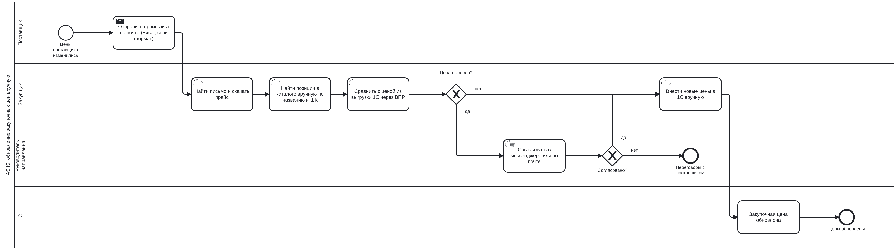
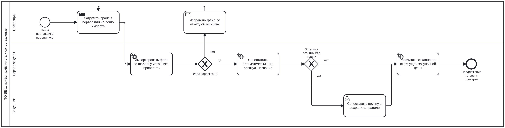
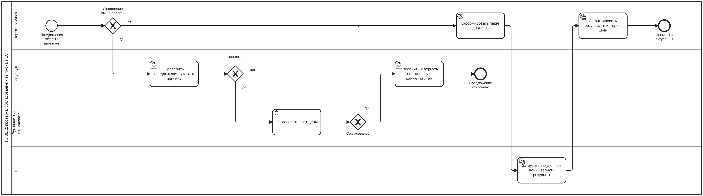

# 2. Бизнес-процессы: AS IS и TO BE

Нотация BPMN 2.0. Исходники открываются в [bpmn.io](https://demo.bpmn.io) или Camunda Modeler: [`bpmn/`](../bpmn).

## AS IS: обновление закупочных цен вручную

| Шаг | Проблема | Решение в TO BE |
|---|---|---|
| Прайс приходит на личную почту закупщика | прайс теряется в переписке, в отпуск закупщика цены не обновляются | общий ящик импорта и загрузка в портале, очередь видна всей команде |
| Поиск позиций в каталоге по названию | у поставщика своё название: «DR PEPPER CHERRY CAN 355ML» против «Dr Pepper Cherry 0,355 л ж/б» | автосопоставление по ШК и артикулу, ручное сопоставление запоминается |
| Сравнение через ВПР | рост цены можно пропустить, особенно при сдвиге строк | отклонение считает система по каждой позиции |
| Согласование в мессенджере | нет истории решений и обоснований | согласование в портале с обязательной причиной |
| Ручной ввод в 1С | опечатки, задержка | пакетная выгрузка в 1С с контролем результата |

## TO BE 1: приём прайса и сопоставление

1. Поставщик загружает прайс в портал или присылает на ящик импорта.
2. Портал разбирает файл по шаблону источника и проверяет: обязательные колонки, формат цены и ШК, дубли строк. Если ошибки критичны (нет колонки цены, не тот лист), файл отклоняется целиком, поставщик получает отчёт с номерами строк. Если ошибки в отдельных строках, они попадают в отчёт, а остальные строки обрабатываются.
3. Портал сопоставляет позиции по правилам из [09-business-rules.md](09-business-rules.md): ШК, затем артикул поставщика, затем похожесть названия как подсказка.
4. Позиции без пары попадают закупщику. Ручное сопоставление сохраняется: в следующем прайсе эта позиция сопоставится сама.
5. Портал считает отклонение от текущей закупочной цены этого поставщика.

## TO BE 2: проверка, согласование и выгрузка в 1С

1. Снижение цены и рост в пределах порога автоприёма принимаются автоматически.
2. Остальное идёт закупщику: новые позиции без текущей цены и рост выше порога.
3. Закупщик принимает или отклоняет. Отказ всегда с комментарием, он уходит поставщику.
4. Если рост выше порога руководителя, закупщик указывает обоснование, и предложение уходит руководителю.
5. Согласованные цены собираются в пакет и выгружаются в 1С. 1С возвращает результат по каждой строке.
6. Портал закрывает старую цену, открывает новую с даты начала действия и хранит историю решений.

## Роли и права

| Действие | Поставщик | Закупщик | Руководитель | Администратор |
|---|---|---|---|---|
| Загрузить прайс | свой | любой | | любой |
| Настроить шаблон источника | | | | да |
| Сопоставить вручную, исключить позицию | | да | | да |
| Принять / отклонить предложение | | да | | |
| Согласовать рост выше порога | | | да | |
| Изменить пороги согласования | | | утверждает | вводит |
| Видеть историю цен и решений | свои позиции | да | да | да |
