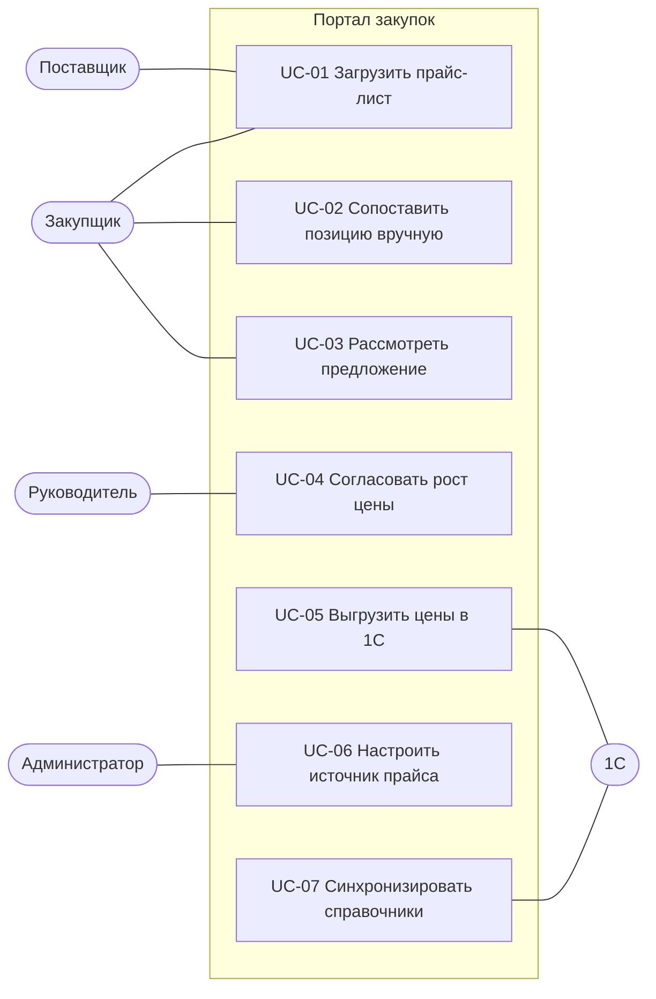

# 3. Варианты использования

---

## UC-01. Загрузить прайс-лист

| | |
|---|---|
| **Актор** | Поставщик или закупщик |
| **Цель** | новые цены поставщика попали в портал и разобраны |
| **Предусловия** | у поставщика есть активный источник с шаблоном разбора; пользователь авторизован |
| **Триггер** | поставщик изменил цены |
| **Постусловия** | создана загрузка в статусе `processed` или `failed`; предложения созданы и маршрутизированы |

**Основной сценарий**

1. Актор открывает «Импорт», выбирает источник и файл (xlsx, xls, csv до 20 МБ).
2. Система считает SHA-256 файла и проверяет, что такой файл по этому источнику ещё не загружали.
3. Система разбирает файл по шаблону источника: лист, строка заголовка, соответствие колонок.
4. Система проверяет строки: обязательные поля, цена числом больше нуля, ШК 8-14 цифр.
5. Система создаёт или обновляет позиции каталога поставщика и предложения по строкам без ошибок.
6. Система сопоставляет позиции и маршрутизирует предложения (UC-03, правила BR-01...BR-04).
7. Система показывает итог: строк всего, с ошибками, сопоставлено, принято автоматически, ждут решения.

**Альтернативы и исключения**

- 2а. Файл уже загружали: система отклоняет загрузку и показывает дату и автора первой загрузки.
- 3а. В файле нет обязательной колонки или листа из шаблона: загрузка `failed`, отчёт об ошибке структуры, предложения не создаются.
- 4а. Ошибки в отдельных строках: строки пропускаются, попадают в отчёт с номером строки, кодом и текстом ошибки; остальные обрабатываются.
- 4б. Ошибок больше 30% строк: загрузка `failed` целиком, это почти всегда сдвинутый шаблон.
- 1а. Прайс пришёл на ящик импорта: отправитель определяет источник по адресу; если адрес неизвестен, письмо уходит администратору.

---

## UC-02. Сопоставить позицию вручную

| | |
|---|---|
| **Актор** | Закупщик |
| **Цель** | позиция поставщика связана с товаром каталога, и в следующий раз сопоставится сама |
| **Предусловия** | есть предложение в статусе `unmatched` |
| **Постусловия** | создано сопоставление `manual`; предложение маршрутизировано |

**Основной сценарий**

1. Закупщик открывает «Сопоставления», фильтр «Без пары».
2. Система показывает позицию поставщика и до 3 подсказок из каталога по похожести названия с процентом схожести.
3. Закупщик выбирает товар из подсказок или ищет по коду 1С, названию, ШК.
4. Система проверяет, что товар активен и не сопоставлен с другой позицией этого же поставщика.
5. Система сохраняет сопоставление с автором и временем, пересчитывает отклонение, маршрутизирует предложение.

**Альтернативы**

- 3а. Позиция не товар (оборудование, промо-материалы): закупщик добавляет её в «Исключённые» с причиной; предложение получает статус `excluded`.
- 3б. Товара нет в каталоге: закупщик создаёт заявку на заведение номенклатуры в 1С (вне портала), предложение остаётся `unmatched`.
- 4а. Товар уже сопоставлен с другой позицией поставщика: система предупреждает и требует подтверждения (бывает при смене артикула у поставщика).

---

## UC-03. Рассмотреть предложение

| | |
|---|---|
| **Актор** | Закупщик |
| **Цель** | принято решение по новой цене |
| **Предусловия** | предложение в статусе `pending_review` |
| **Постусловия** | статус `approved`, `pending_approval` или `rejected`; решение записано в историю |

**Основной сценарий**

1. Закупщик открывает очередь «Предложения»: сортировка по отклонению, сверху самый большой рост.
2. Система показывает текущую и новую цену, отклонение, историю цен по товару, цены других поставщиков на этот товар.
3. Закупщик принимает предложение.
4. Если рост не выше порога руководителя, предложение получает статус `approved`.

**Альтернативы**

- 4а. Рост выше порога руководителя или новая позиция без текущей цены: система требует обоснование и переводит в `pending_approval`.
- 3а. Закупщик отклоняет: обязателен комментарий; статус `rejected`, поставщику уходит уведомление с комментарием.
- 3б. Массовое решение: закупщик выбирает несколько предложений одного поставщика и принимает их одним действием, если ни одно не требует руководителя.

---

## UC-04. Согласовать рост цены

| | |
|---|---|
| **Актор** | Руководитель направления |
| **Предусловия** | предложение в статусе `pending_approval` |
| **Постусловия** | `approved` или `rejected`; решение записано |

**Основной сценарий**

1. Руководитель получает уведомление: ежедневный дайджест в 10:00 и сразу, если рост выше 25%.
2. Открывает предложение: отклонение, обоснование закупщика, влияние на маржу по продажам за 4 недели.
3. Согласует или отклоняет с комментарием.

**Исключение**

- 3а. Решения нет 2 рабочих дня: система напоминает руководителю и показывает просрочку в «Сводке».

---

## UC-05. Выгрузить цены в 1С

| | |
|---|---|
| **Актор** | Система (по расписанию), закупщик (вручную) |
| **Предусловия** | есть предложения в статусе `approved` |
| **Постусловия** | `exported` или `export_failed` по каждому предложению; история цен обновлена |

**Основной сценарий**

1. По расписанию каждые 30 минут система собирает `approved` в пакет с ключом идемпотентности.
2. Отправляет пакет в 1С (детали: [06-integration-1c.md](06-integration-1c.md)).
3. 1С загружает цены и возвращает результат по каждой строке.
4. Система по успешным строкам закрывает старую цену, открывает новую, ставит `exported`.

**Исключения**

- 3а. 1С недоступна: повтор через 5, 15, 60 минут с тем же ключом; после третьей неудачи уведомление администратору.
- 3б. Ошибка по строке (номенклатура заблокирована, нет договора): строка `export_failed`, текст ошибки виден закупщику, остальные строки загружены.

---

## UC-06. Настроить источник прайса

Администратор указывает поставщика, канал, лист и строку заголовка, сопоставляет колонки файла с полями (артикул, ШК, название, цена, кратность), признак «цены с НДС». Перед сохранением система разбирает пробный файл и показывает первые 20 строк так, как их поймёт импорт.

## UC-07. Синхронизировать справочники

Система получает из 1С изменения каталога номенклатуры и базы ШК (инкрементально, по версии). Клиент портала при входе сверяет версию справочника и догружает только изменения (NFR-01).
