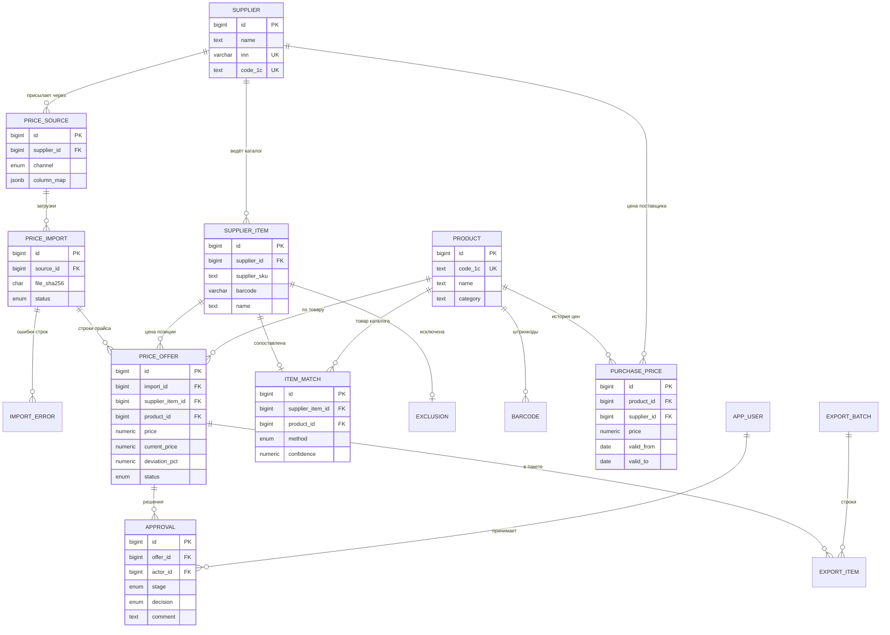
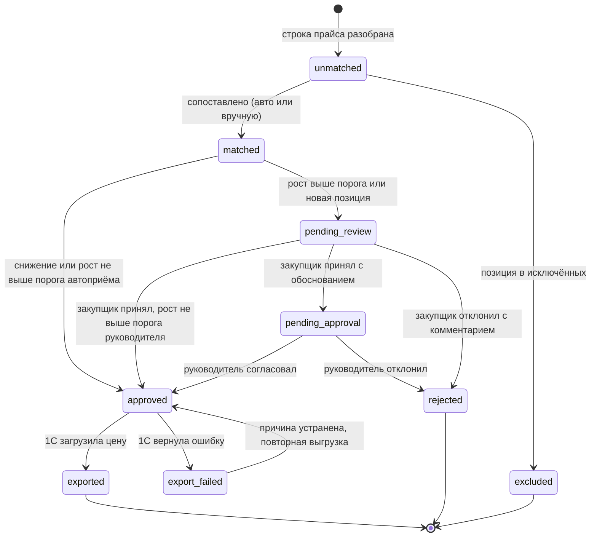

# 5. Модель данных

Физическая модель для PostgreSQL: [`sql/01_schema.sql`](../sql/01_schema.sql). Ниже логическая модель, словарь ключевых полей и статусная модель предложения.

## ER-диаграмма

## Ключевые решения

| Решение | Почему |
|---|---|
| Позиция поставщика (`supplier_item`) отделена от предложения (`price_offer`) | сопоставление делается один раз на позицию, а не на каждую строку каждого прайса |
| Одно действующее сопоставление на позицию (`UNIQUE supplier_item_id`) | однозначно, какой товар получит цену |
| ШК может висеть на нескольких товарах (`PK barcode, product_id`) | так бывает в 1С; правило BR-01 не сопоставляет по неоднозначному ШК |
| `purchase_price` с `valid_from` / `valid_to` и частичным уникальным индексом | история цен; на пару товар + поставщик не больше одной действующей цены |
| `file_sha256` уникален в рамках источника | защита от повторной загрузки того же файла |
| Отказ в `approval` только с комментарием (`CHECK`) | у поставщика и аудита всегда есть причина |
| `export_batch.idempotency_key` | повторная отправка пакета не создаёт цены дважды |
| `dictionary_version` | клиент догружает только изменения справочников (NFR-01) |

## Словарь данных: PRICE_OFFER

| Поле | Тип | Обяз. | Описание | Правило |
|---|---|---|---|---|
| id | bigint | да | идентификатор | |
| import_id | bigint | да | загрузка, из которой пришла строка | |
| supplier_item_id | bigint | да | позиция поставщика | уникально в рамках загрузки |
| product_id | bigint | нет | товар каталога | обязателен во всех статусах, кроме `unmatched` и `excluded` |
| price | numeric(12,2) | да | новая цена за единицу с НДС, руб | больше 0; если в источнике без НДС, пересчитывается при импорте |
| vat_rate | numeric(4,2) | да | ставка НДС | 0, 10 или 20 |
| valid_from | date | да | дата начала действия | из файла или дата загрузки + 1 день |
| current_price | numeric(12,2) | нет | действующая закупочная цена этого поставщика | пусто для новой позиции |
| deviation_pct | numeric(7,2) | нет | отклонение, % | (price - current_price) / current_price × 100, до сотых |
| status | enum | да | статус | см. статусную модель |
| reason | text | нет | обоснование закупщика | обязательно при передаче руководителю |

## Статусная модель предложения

Переходы проверяются на стороне сервера: функция `decide_offer` в [`sql/02_business_rules.sql`](../sql/02_business_rules.sql) отклоняет решение не той роли или из не того статуса.
