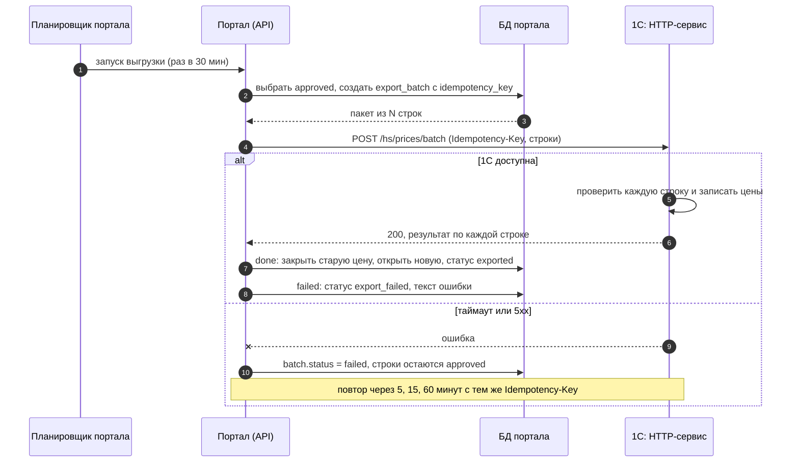
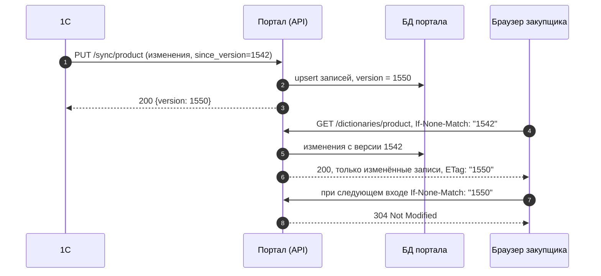

# 6. Интеграция с 1С

## Обмены

| # | Направление | Что | Когда | Способ |
|---|---|---|---|---|
| I-1 | 1С -> портал | каталог номенклатуры, база ШК, поставщики | каждые 15 минут, изменения с последней версии | 1С вызывает REST API портала (`PUT /sync/{dictionary}`) |
| I-2 | 1С -> портал | действующие закупочные цены | раз в сутки в 05:00, полная сверка | файл JSON в обменном каталоге, хеш файла в имени |
| I-3 | портал -> 1С | согласованные закупочные цены | каждые 30 минут и по кнопке | HTTP-сервис 1С `POST /hs/prices/batch` |
| I-4 | 1С -> портал | результат загрузки пакета | синхронно в ответе I-3 | |

Почему так: мастер-данные живут в 1С, поэтому 1С сама отправляет изменения справочников (I-1). Цены пишет только обработка на стороне 1С (I-3): портал не обращается к базе 1С напрямую, и все проверки 1С (блокировка номенклатуры, договор с поставщиком) срабатывают.

## Выгрузка цен (I-3, I-4)



### Запрос

```http
POST /hs/prices/batch HTTP/1.1
Idempotency-Key: 3f1c2a9e-7b4d-4c1e-9a55-0d2f6b8e1c07
Content-Type: application/json
```

```json
{
  "batch_id": 128,
  "created_at": "2026-10-30T10:30:00+03:00",
  "items": [
    {
      "offer_id": 3,
      "product_code_1c": "Т1-00031001",
      "supplier_code_1c": "П-0001",
      "price": 182.00,
      "vat_rate": 20,
      "valid_from": "2026-11-01",
      "approved_by": "head.petrov"
    }
  ]
}
```

### Ответ

```json
{
  "batch_id": 128,
  "items": [
    { "offer_id": 3, "status": "done" },
    { "offer_id": 6, "status": "failed", "error_code": "ITEM_LOCKED", "error": "Номенклатура заблокирована в 1С" }
  ]
}
```

### Маппинг полей

| Портал | 1С | Преобразование |
|---|---|---|
| `product.code_1c` | Справочник «Номенклатура», реквизит «Код» | как есть |
| `supplier.code_1c` | Справочник «Контрагенты», «Код» | как есть |
| `price_offer.price` | Регистр сведений «Цены номенклатуры поставщиков», ресурс «Цена» | число, 2 знака |
| `price_offer.vat_rate` | «Ставка НДС» | 0 / 10 / 20 -> перечисление «Без НДС» / «НДС10» / «НДС20» |
| `price_offer.valid_from` | «Период» записи регистра | дата без времени |
| `approval.actor` | комментарий документа «Установка цен номенклатуры поставщика» | «Согласовано в портале: логин, дата» |

### Коды ошибок 1С

| Код | Причина | Действие портала |
|---|---|---|
| `ITEM_NOT_FOUND` | код номенклатуры не найден | `export_failed`, задача администратору справочников |
| `ITEM_LOCKED` | номенклатура помечена на удаление или заблокирована | `export_failed`, видно закупщику |
| `NO_CONTRACT` | нет действующего договора с поставщиком | `export_failed`, видно закупщику |
| `PERIOD_CLOSED` | дата начала в закрытом периоде | `export_failed`, закупщик меняет дату |
| `VALIDATION` | прочие ошибки проверки | `export_failed` с текстом ошибки |

### Идемпотентность и согласованность

- Ключ `Idempotency-Key` создаётся один раз на пакет. 1С хранит ключи 7 дней и на повторный запрос с тем же ключом возвращает сохранённый ответ.
- Строка пакета меняет статус в портале только по ответу 1С. Если ответа нет, строки остаются `approved` и уйдут в следующем пакете.
- Ежедневная сверка I-2: если цена в 1С не совпадает с последней `exported` в портале, расхождение попадает в «Ошибки» (метрика M-4).

## Синхронизация справочников (I-1)


